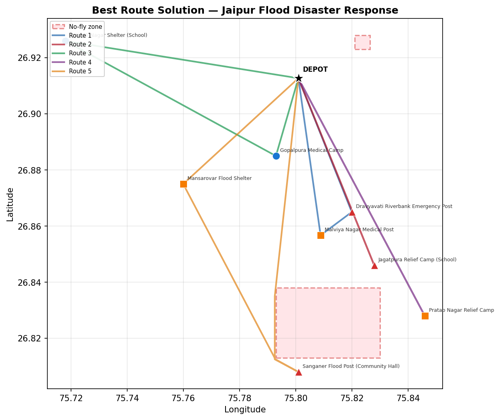
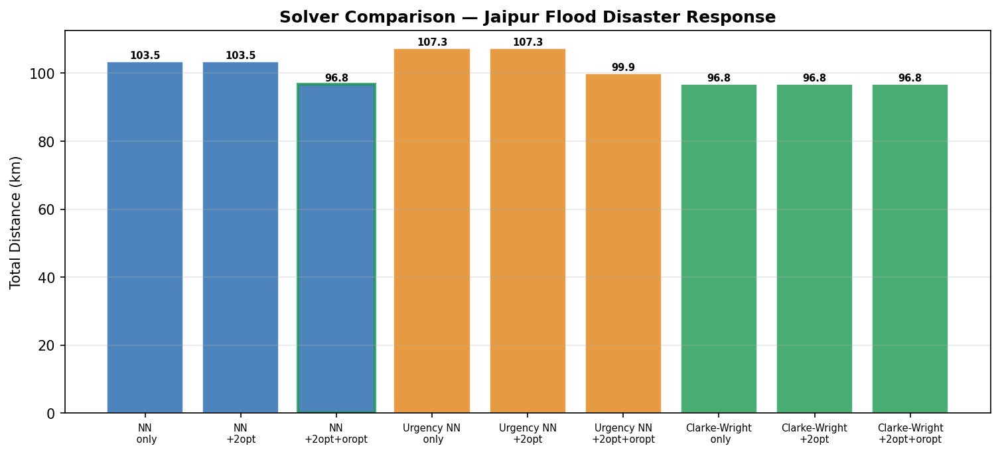

# Med-Drone Mission Control

**Single-UAV Autonomous Medical Delivery & Disaster Logistics Testbed**

An autonomous mission control prototype and operations-research testbed for emergency medical drone delivery in disaster-affected areas. When catastrophic flooding, earthquakes, or infrastructure collapses sever surface road networks, the primary operational system plans, validates, executes, and supervises a **single autonomous multi-rotor UAV** over MAVLink in **ArduPilot SITL**—transporting critical medical supplies (vaccines, blood units, antivenom, and insulin) under 4D airspace restrictions, first-principles battery energy budgets, time-based cold-chain limits, proximity-based obstacle avoidance, and site-suitability-aware delivery protocols.

### System Scope & Architecture Tiers

1. **Primary Operational System — Single-UAV Autonomy & ArduPilot SITL Flight Stack (`flightstack/`, `sitl_mission_demo.py`, `gdacs_provider.py`, `airspace_provider.py`)**:
   - Reference aircraft (`MedDrone-Hexa-16` in `JAIPUR_SINGLE_UAV`: 8.0 kg max payload, 17.5 kg MTOW, 6S 16 Ah / 284.16 Wh usable battery with 20% reserve floor, 10 m/s cruise, 18.0 km physics-grounded nominal range) connected via a single MAVLink link to real ArduCopter V4.7.0-dev SITL firmware.
   - End-to-end closed loop: live external GDACS disaster alert ingestion (`LIVE_EXTERNAL` / `CACHED` with mandatory attribution), official DigitalSky OpenAPI 3.0 flight-plan validation contract (`OFFICIAL_API_VALIDATION`, honestly gated when pilot JWT credentials are absent), 4D (altitude- and time-bounded) NFZ/TFR route validation, item-by-item MAVLink mission upload/readback verification, native ArduPilot C++ proximity-sensor raycasting (`AP_Proximity_SITL` `PRX1_TYPE=10` + `OA_TYPE=1` BendyRuler + `AP_OADatabase` telemetry feedback), in-flight dynamic replanning from live EKF position with hard 4-gate feasibility enforcement (MTOW, fresh battery Wh without 100% fallback, cold-chain, and delivery time windows), site-suitability-aware hover vs. landing delivery state machine (`MAV_CMD_NAV_DELAY = 93` `ContinueAfterLand`), and battery reserve failsafe supervision.
2. **Optional Logistics-Planning & Research Component — Multi-Drone CVRP & Fleet Simulator (`vrp_scratch.py`, `simulate_fleet.py`, `replan.py`)**:
   - From-scratch multi-heuristic Capacitated Vehicle Routing Problem (CVRP) solver and discrete-event multi-drone fleet simulator retained for logistics research and algorithm benchmarking.
3. **Future Extension — Simultaneous Multi-UAV Autonomous Control**:
   - Simultaneous multi-aircraft MAVLink control and deconfliction in SITL is **not** a current implementation requirement and remains scoped as future work.

<p align="center">
  
</p>
<p align="center">
  <em>Multi-drone fleet routing across flooded Jaipur with A* detours around restricted airspace.</em>
</p>

---

## Core Technical Highlights

The platform integrates operations research, computational geometry, discrete-event simulation, and computer vision into an integrated mission architecture:

- **From-Scratch Multi-Heuristic CVRP Solver**: Implements three independent construction heuristics (Nearest Neighbor, Urgency-Weighted Nearest Neighbor, and Clarke-Wright Savings) with intra-route 2-opt and inter-route Or-opt relocate operators. Evaluates all candidates and selects the best feasible solution found across multiple construction heuristics and local-search passes.
- **Simultaneous Multi-Constraint Routing**: Jointly enforces vehicle payload capacity, flight range energy budgets (with reserve margins), cumulative cold-chain thermal decay limits, and strict delivery deadline time windows.
- **NFZ/TFR-Aware A\* Pathfinding**: Automatically routes around polygon no-fly zones and pop-up Temporary Flight Restrictions. Uses conservative axis-aligned bounding box (AABB) pre-filtering, 8-connected grid search, corner-cutting prevention, and bidirectional string-pulling path smoothing.
- **50 m Safety-Clearance Enforcement**: Enforces a configured 50-meter safety margin around all obstacle edges. Automatically scales cell diagonal compensation when large search areas trigger grid coarsening under `MAX_CELLS = 120`.
- **Sub-Second Dynamic Replanning**: Injects mid-mission disruptions (pop-up TFRs, urgent medical requests, drone motor failures) and re-solves remaining stops from live airborne GPS positions and remaining cargo/range budgets in approximately **0.20–0.26 s** (8 stops) to **0.61–0.79 s** (15 stops) on the tested machine.
- **Physical Infeasibility Diagnosis**: Immediately catches and diagnoses physically impossible missions (e.g. destinations exceeding round-trip battery range or locations trapped inside restricted airspace) before dispatch.
- **Multi-Drone Discrete-Event Fleet Simulator**: Simulates time-stepped fleet execution with realistic vehicle state machines (`IDLE`, `DISPATCHED`, `TRANSIT`, `DELIVERING`, `RETURNING`, `CHARGING`, `HOLD`), physical depot departures, and live telemetry logging.
- **MAVLink / QGroundControl WPL 110 Export**: Generates industry-standard mission files compatible with ArduPilot and PX4 autopilots, embedding intermediate detour waypoints and payload delivery hover/dwell times.
- **Computer Vision Landing Zone Screening**: Integrates YOLOv8 obstruction screening to verify landing pad safety (detecting people, vehicles, and debris) prior to descent.
- **Autopilot Flight Stack & SITL Integration**: End-to-end integration with ArduPilot SITL over MAVLink (`flightstack/`). Supports both hover-and-release and land-and-deliver modes, live EKF/battery telemetry ingestion with staleness rejection, 4D (altitude- and time-bounded) airspace conflict detection triggering automated `LOITER` and re-planning, and native ArduPilot proximity-sensor obstacle avoidance (`PRX1_TYPE=2` / `OBSTACLE_DISTANCE` + `OA_TYPE=1` BendyRuler) coupled with 3D CPA collision supervision.
- **Exhaustive Automated Testing & CI**: Includes 180+ automated tests covering geometry, routing heuristics, constraints, simulation mechanics, export formats, MAVLink telemetry, item-by-item mission readback, separated payload delivery state machine, site suitability assessment, 4D NFZ/TFR validation, streaming YOLO perception, ArUco precision landing, and dynamic collision avoidance.

<p align="center">
  
</p>
<p align="center">
  <em>Heuristic benchmark comparison — the multi-start pipeline balances route quality and computational overhead.</em>
</p>

---

## Dynamic Replanning & Measured Performance

Traditional routing systems treat pre-flight plans as static commitments. When unexpected disruptions occur mid-flight, Med-Drone Mission Control replans dynamically:

1. **Airborne State Propagation**: Active drones do not reset to depot; they are treated as dynamic moving origins initialized with their live GPS coordinates, remaining battery range budget, and onboard payload.
2. **Emergency Cargo Dispatch**: Newly injected urgent requests originate physically from the depot; idle drones dispatch immediately, or requests queue until a vehicle returns.
3. **Pop-Up TFR Handling**: If a flight corridor is abruptly closed by an emergency airspace restriction, affected drones immediately compute an A* escape vector and reroute around the perimeter.
4. **Failure Redistribution**: If a drone suffers motor failure, its undelivered stops are reassigned across the remaining healthy fleet.

### Measured Empirical Benchmarks

These timings represent measured benchmark results on the tested machine (Apple Silicon Mac, M-series, Python 3.10+) across the specified scenarios, demonstrating sub-second response across cold-cache and warm-cache runs:

- **8-Stop Replan** (Jaipur Disaster): approximately **0.20–0.26 s** (~201 ms warm cache, ~254 ms cold cache)
- **15-Stop Replan** (Multi-obstacle random clusters): approximately **0.61–0.79 s** (~617 ms warm cache, ~801 ms cold cache)
- **Distance Matrix Construction**: ~200–258 ms (Jaipur, 18 detours), ~206–280 ms (Chennai, 12 detours)

| Operation | Scenario / Scale | Cold Cache (Mean) | Warm Cache (Mean) |
| :--- | :--- | :---: | :---: |
| **Flight Distance Matrix** | Jaipur Disaster (9 locs, 18 detours) | ~258 ms | ~202 ms (min: ~200 ms) |
| **Flight Distance Matrix** | Chennai Flood (8 locs, 12 detours) | ~280 ms | ~206 ms (min: ~205 ms) |
| **8-Stop Dynamic Replan** | Jaipur Disaster (8 deliveries, 2 NFZs) | ~254 ms | ~201 ms (min: ~200 ms) |
| **15-Stop Dynamic Replan** | Multi-Obstacle Clusters (5 seeds) | ~801 ms | ~617 ms (min: ~91 ms) |

For the tested 8–15-stop scenarios, full replanning remains sub-second to low-second (~0.20–0.26 s for 8 stops, ~0.61–0.79 s for 15 stops on the tested machine), using full replanning rather than partial-graph repair heuristics.

To reproduce these benchmarks on your machine:
```bash
python3 benchmarks/benchmark_replanning.py
```

---

## Architecture

```
config.py              → Scenario definition: depot, delivery stops, polygon NFZs, drone parameters
   ↓
distance_matrix.py     → Flight distance matrix (straight-line + A* detour paths)
+ nofly_astar.py       → 8-connected grid A* with AABB filtering, corner-cutting blocks, string-pulling
   ↓
vrp_scratch.py         → Clarke-Wright + Nearest-Neighbor + Urgency-NN → 2-opt → Or-opt
   ↓
cold_chain.py          → Cumulative refrigeration exposure verification
time_windows.py        → Urgent and scheduled delivery deadline evaluation
yolo_safety.py         → Landing site visual obstruction screening (YOLOv8)
   ↓
waypoint_export.py     → MAVLink QGroundControl WPL 110 mission export for ArduPilot/PX4
```

**Primary Single-UAV Flight Stack & ArduPilot SITL Layer:**
```
config.py (JAIPUR_SINGLE_UAV) + airspace_provider.py (4D AirspaceZone / Scenario / GeoJSON)
   ↓
flightstack/mission.py       → 4D NFZ/TFR A* pathfinding, SiteSuitability mode selection, MAVLink items
   ↓
flightstack/mavlink_link.py  → MAVLink upload + item-by-item readback verification + 33 Hz OBSTACLE_DISTANCE stream
   ↓
flightstack/mission_runner.py → Closed-loop AUTO execution, 4D conflict detection & LOITER replanning,
                                native ArduPilot OA supervision, separated payload delivery state machine
```

**Optional Multi-Drone Logistics Simulator Layer (`simulate_fleet.py`):**
```
simulate_fleet.py      → Discrete-event fleet engine with vehicle state machines
   ↓
replan.py              → Dynamic mid-flight re-solver from live GPS coordinates
   ↓
build_interactive_sim.py → Standalone Leaflet.js mission replay visualizer
```

---

## Quick Start

The core engine is built entirely with the Python standard library—**zero third-party dependencies required** to run the routing pipeline, replanner, test suite, and benchmarks.

```bash
git clone https://github.com/Atharv-Garg446/Med-Drone-Mission-Control.git
cd Med-Drone-Mission-Control

# 1. Check and prepare the real environment (Apple Silicon, dependencies, SITL, cameras)
python3 check_env.py
./setup_env.sh

# 2. Run the core routing pipeline (pure standard library)
python3 main.py --no-osmnx

# 3. Run discrete-event fleet simulation with disruptions
python3 run_simulation.py --events 5
# Open the generated interactive playback: http://localhost:8080/output/interactive_sim.html

# 4. Run reproducible benchmarks and all 166 automated unit & acceptance tests
python3 benchmarks/benchmark_replanning.py
python3 -m unittest discover -s tests -p "test_*.py" -v
```

### Optional Dependencies

For expanded visualization, benchmarking, and vision screening:

```bash
pip install -r requirements.txt
```

For the real ArduPilot SITL flight stack:
```bash
pip install -r requirements-sitl.txt
```

| Dependency | Purpose |
|---|---|
| `pymavlink` | MAVLink communication with ArduPilot / PX4 (`flightstack/mavlink_link.py`) |
| `folium` | Generates interactive browser route maps (`visualize_map.py`) |
| `ortools` | Google OR-Tools comparative routing baseline (`vrp_ortools.py`) |
| `ultralytics` | YOLOv8 landing zone obstruction detection (`yolo_safety.py`) |
| `matplotlib` | Static publication-grade route and convergence plots (`plots.py`) |
| `streamlit` | Interactive web dashboard (`dashboard.py`) |
| `osmnx` | Optional surface road network distance comparison (`distance_matrix.py`) |

---

## Built-in Operational Scenarios

The system ships with calibrated disaster scenarios modeled after real-world events:

- **Jaipur Flood Disaster Response**: Monsoon flooding along the Dravyavati River basin. SMS Hospital serves as the central elevated depot; 8 delivery locations distribute antivenom, blood, and emergency packs across flooded relief camps around Jaipur Airport and Secretariat no-fly zones.
- **Chennai Cyclone Response**: Modeled after historic South Indian coastal flooding. Rajiv Gandhi Government General Hospital acts as depot, distributing medical supplies across 7 submerged southern medical posts while navigating Chennai Airport and Guindy National Park airspace.
- **Jaipur Hospital Network (Routine)**: Demonstrates system versatility on routine daily restock operations under normal flight conditions.

### Arbitrary Geographies

Any GPS location can be targeted dynamically:
```bash
python3 main.py --random-at 40.7580 -73.9855      # Manhattan, NY
python3 main.py --random-at 35.6586 139.7454       # Tokyo, Japan
python3 main.py --from-json custom_mission.json    # User-defined mission JSON
```

---

## Autopilot & Flight Stack Integration (ArduPilot SITL)

In addition to static mission export, Med-Drone Mission Control integrates directly with **ArduPilot SITL** over MAVLink:

1. **One-Command SITL Mission Execution**:
   ```bash
   python3 sitl_mission_demo.py --speedup 5
   ```
2. **Deterministic Mid-Flight Airspace Update**:
   ```bash
   python3 sitl_mission_demo.py --airspace-change --speedup 5
   ```
   Injects an airspace restriction mid-air; the mission runner detects the conflict (evaluating 2D polygon + altitude floor/ceiling + validity time window), commands `LOITER`, re-plans the remaining stops from the autopilot's live position estimate, re-validates energy/cold-chain/time-window constraints, uploads the updated mission, and resumes in `AUTO` mode.
3. **In-Flight Sensor-Driven Obstacle Avoidance (`AP_Proximity_SITL` C++ Raycaster)**:
   ```bash
   python3 sitl_mission_demo.py --inject-obstacle --speedup 10
   ```
   Uploads cylindrical world obstacles into ArduPilot's `AC_PolyFence_loader` (`MAV_MISSION_TYPE_FENCE = 1`, `FENCE_ENABLE = 0`) where ArduCopter's native C++ proximity driver (`AP_Proximity_SITL`, `PRX1_TYPE = 10`) casts 8 horizontal rays in real time, populates `AP_OADatabase` (`OA_DB`), streams `DISTANCE_SENSOR` and `ADSB_VEHICLE` telemetry over MAVLink, and steers the aircraft smoothly around the obstacle via `AP_OABendyRuler` (`OA_TYPE = 1`).
4. **Delivery Modes & Site Suitability Assessment**:
   - Separates the delivery lifecycle into distinct state transitions: `LOADED → ARRIVED → SITE_ASSESSED → METHOD_SELECTED → RELEASE_COMMANDED → RELEASE_ACKNOWLEDGED → CUSTODY_CONFIRMED → DELIVERY_COMPLETE`.
   - `hover`: Descends to release altitude, triggers simulated gripper (`MAV_CMD_DO_GRIPPER`), waits for causal ArduPilot `STATUSTEXT` acknowledgement (`simulated_hover_gripper_release`), climbs and proceeds. Note: `recipient_handover_verified=False` in simulation — actuator release is not custody confirmation.
   - `land`: Evaluates `SiteSuitability` (surface condition, slope, clearance); automatically downgrades unsafe/flooded sites to `hover` delivery, or executes `MAV_CMD_NAV_LAND`, `MAV_CMD_DO_GRIPPER`, `MAV_CMD_NAV_DELAY` (`93`) 5-second ground dwell (`simulated_ground_dwell_handoff`), and resumes via `MAV_CMD_NAV_TAKEOFF` (`MIS_OPTIONS = 4` `ContinueAfterLand`).

### Engineering & Architecture Documentation (`docs/`)
- [docs/architecture.md](docs/architecture.md) — End-to-end system architecture, control boundaries, and single-UAV vs. fleet separation.
- [docs/data_sources_and_provenance.md](docs/data_sources_and_provenance.md) — Live GDACS API contract, DigitalSky OpenAPI 3.0 specification, Mappls layer classification, and `SourceClassification` taxonomy.
- [docs/simulation_setup.md](docs/simulation_setup.md) — Apple M3 (8 GB RAM, macOS 26.2) feasibility analysis and C++ `AP_Proximity_SITL` (`PRX1_TYPE = 10`) sensor architecture.
- [docs/mission_execution.md](docs/mission_execution.md) — 4-gate replan feasibility checks, delivery state machine, and `MAV_CMD_NAV_DELAY = 93` landing continuation mechanics.
- [docs/known_limitations.md](docs/known_limitations.md) — Honest scope boundaries and prototype limitations.
- [docs/demo_guide.md](docs/demo_guide.md) — Exact commands to reproduce all unit tests, controlled OA comparisons, and SITL missions.
- [docs/interview_technical_notes.md](docs/interview_technical_notes.md) — University application and technical interview defence guide.
- [docs/engineering_decisions/](docs/engineering_decisions/) — Architecture Decision Records (`ADR-001` through `ADR-004`).

---

## Disaster-Response Operational Parameters & Future Development Roadmap

While the current prototype models 4D airspace restrictions, time-based cold-chain limits, urgent time windows, first-principles battery discharge, proximity-based obstacle avoidance, and landing-site suitability, real-world disaster-response logistics involve additional environmental and infrastructure variables. The table below distinguishes what is implemented in the current simulation baseline from planned future development:

| Disaster Parameter | Operational Impact on Medical Drone Logistics | Current Prototype Status | Planned Future Development |
| :--- | :--- | :--- | :--- |
| **Flood Extent & Inundation Depth** | Submerges ground handoff points, shifts displaced populations to high ground, and invalidates ground-landing pads. | Scenario stops represent flood-isolated relief camps; `SiteSuitability` downgrades `land` to `hover` when surface is marked `flooded`. | Ingest dynamic SAR/optical flood-extent rasters (e.g., Sentinel-1 / ISRO Bhuvan) to auto-update delivery coordinates and site surface states. |
| **Damaged Infrastructure & Vertical Hazards** | Toppled cranes, downed transmission lines, and collapsed towers create low-altitude collision hazards below published airspace floors. | Simulated via `ObstacleTracker` 3D tracks, 72-bin `OBSTACLE_DISTANCE` MAVLink proximity feed (`PRX1_TYPE=2`), ArduPilot BendyRuler, and A* exclusion polygons. | Integrate onboard stereo/LiDAR 3D occupancy mapping (OctoMap) in Gazebo/ROS 2 for real-time wire and tower detection. |
| **Surface Road Accessibility** | Determines whether a clinic truly requires aerial resupply or can be reached by ground ambulance/truck, and constrains mobile depot repositioning. | Optional `osmnx` road-distance comparison against aerial Haversine/A* routes in `distance_matrix.py`. | Joint truck-drone (tandem VRP) routing where ground vehicles carry mobile launch pads up to flood/debris roadblocks. |
| **Ground Debris & Surface Slope** | Rubble, mud, fallen trees, and pitched roofs cause tip-over on touchdown. | Modeled in `SiteSuitability` (`surface_condition`, `slope_deg <= 10°`, `obstacle_clearance_m >= 5 m`) and YOLOv8 visual pad screening (`yolo_safety.py`). | Real-time downward point-cloud plane fitting (RANSAC slope/roughness estimation) prior to committing to `MAV_CMD_NAV_LAND`. |
| **Smoke, Heavy Rain & Visibility Degradation** | Degrades optical camera detectors (YOLOv8, ArUco fiducials) and attenuates LiDAR rangefinders. | Perception pipeline (`flightstack/perception_pipeline.py`) enforces confidence thresholds and rejects uncalibrated/missing depth rather than hallucinating range. | Multi-modal sensor fusion (thermal IR + millimeter-wave radar proximity) and visibility-based minimum altitude/speed derating. |
| **Communications Degradation & Link Loss** | Cellular/RF blackouts in disaster zones interrupt GCS-to-UAV telemetry and in-flight replan uploads. | `TelemetryState` enforces strict staleness limits (`StaleTelemetryError`), suspends planner commands during link dropouts, and relies on onboard ArduPilot `AUTO`/failsafe execution. | Delay-tolerant networking (DTN), LoRa/mesh heartbeat fallback, and pre-uploaded onboard contingency loiter/recovery corrals. |
| **GNSS Integrity & Multipath / Spoofing** | Urban canyons, ionospheric disturbances, or interference degrade position fixes and EKF innovation gates. | Ingests `GPS_RAW_INT` (`fix_type`, `eph`, `satellites_visible`) and `EKF_STATUS_REPORT` flags in `flightstack/telemetry.py`; blocks arming until 3D fix + EKF healthy. | Visual-inertial odometry (VIO) dead-reckoning fallback when GNSS HDOP/innovation breaches safety thresholds. |
| **Vehicle Health & Actuator Degradation** | Motor/ESC overheating, cell imbalance, vibration spikes, or jammed release mechanisms require immediate mission abortion or fleet reassignment. | Tracks battery SoC reserve floor (`battery_reserve_pct` -> `RTL`), MTOW/power curves (`vehicle_model.py`), gripper STATUSTEXT feedback, and fleet motor-failure reassignment (`replan.py`). | Real-time MAVLink `VIBRATION` and ESC telemetry monitoring with predictive remaining-useful-energy estimation under headwind/degraded-propulsion states. |
| **Medicine-Specific Cargo Constraints** | Blood products, vaccines, and antivenom have distinct thermal decay tolerances, shock/g-load limits, and custody verification requirements. | Per-stop `cold_chain_limit_minutes`, `window_minutes` urgency deadlines, mass accounting, and separated `RELEASE_ACKNOWLEDGED` vs. `CUSTODY_CONFIRMED` states (`payload.py`). | Active insulated-compartment temperature telemetry logging (`TEMP` sensor stream) and cryptographic recipient handoff token verification. |
| **Delivery-Site Suitability & Handoff Protocol** | Crowd encroachment around relief camps makes ground landing hazardous even on flat terrain. | `SiteSuitability` assessment at arrival waypoint plus YOLOv8 person/vehicle detection and simulated gripper hover-release fallback (`SIM_GRIPPER_HOVER_RELEASE`). Note: `recipient_handover_verified=False` in simulation. | Automated acoustic/visual crowd-warning annunciation and closed-loop load-cell/optical handover verification for recipient custody confirmation. |

---

## Engineering Boundaries & Operational Scope

Med-Drone Mission Control is an algorithmic testbed and simulation prototype. Operational deployment requires noting specific scope boundaries:

- **Range Energy Model**: Employs first-principles momentum theory and parasitic drag curves (`flightstack/vehicle_model.py`) alongside discrete Haversine reserve checks, distinguishing modeled aircraft power from uncalibrated SITL battery telemetry.
- **Airspace Regulation**: Ingests GeoJSON layers with temporal validity windows and cache fallback (`airspace_provider.py`). Digital Sky flight plan intersection checks require pilot credentials and official schema specifications.
- **OR-Tools Baseline Scope**: Serves as a comparative baseline for capacity- and range-constrained routing; it does not model the custom cumulative cold-chain exposure limits or time-window urgency discounts implemented in the primary solver.
- **Landing Vision Verification**: Pretrained YOLOv8 provides aerial scene screening; ArUco fiducial target estimation (`flightstack/precision_landing.py`) maps optical coordinates to MAVLink `LANDING_TARGET` Body-NED frames.

---

## Testing & Quality Assurance

```bash
python3 -m unittest discover -s tests -p "test_*.py" -v
```

The test suite consists of **149 automated tests using Python's standard-library unittest framework** (plus 1 opt-in SITL hardware-in-the-loop test):
- **Geometry & Spherical Math**: Haversine distances, ray-casting point-in-polygon parity, segment-to-polygon distance, AABB pre-filtering equivalence.
- **A\* Pathfinding & Airspace Safety**: Obstacle avoidance, corner-cutting block enforcement, 50 m safety-clearance enforcement, `MAX_CELLS` coarsened grid handling, pop-up TFR escape vectors, dead-edge detection.
- **Routing Heuristics & Local Search**: Nearest-Neighbor, Clarke-Wright Savings, Urgency NN, 2-opt segment reversals, Or-opt relocate operators.
- **Hard Operational Constraints**: Cumulative cold-chain exposure, delivery deadline windows, payload capacity, return-to-base range bounds, infeasibility validation.
- **Fleet Simulation & Replanning**: Discrete-event mission execution, state transitions, dynamic mid-air replanning, disruption response.
- **Flight Stack & MAVLink Protocols**: Telemetry decoding, staleness and validity filtering, mission upload/readback protocols, command ACK validation.
- **Airspace Providers**: GeoJSON parsing, category policy enforcement, temporal filtering, cached fallback with stale flagging, and credential gating.
- **Vehicle Physics & Energy**: Mass accounting, MTOW enforcement, hover and cruise power curves, payload-dependent discharge.
- **Perception & Collision Kinematics**: Optical to Body-NED transforms, ArUco detection fallbacks, 3D relative kinematics, CPA conflict prediction.

All commits are continuously validated on GitHub Actions across Python 3.10, 3.11, and 3.12.

---

## License

MIT License. See [LICENSE](LICENSE) for details.
