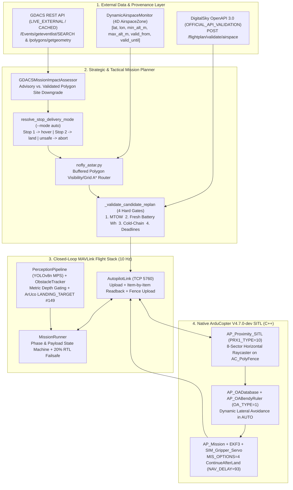

# Med-Drone Mission Control — Complete Technical Architecture & University Interview Master Guide

**Repository**: `/Users/mahigarg/Documents/Drone Shit/drone_medical_router`  
**Primary Scenario**: Jaipur Single-UAV Medical Autonomy Reference (`jaipur_single_uav`)  
**Autopilot Firmware**: ArduCopter V4.7.0-dev (Native Apple Silicon `arm64` SITL)  
**Target Audience**: University Admissions Committees, Robotics/Autonomy Faculty, and Technical Interviewers

---

## 1. Executive Technical Pitch (60 Seconds)

> *"Med-Drone Mission Control is a single-UAV autonomous medical-delivery and disaster-response flight stack integrated closed-loop with ArduCopter V4.7.0-dev SITL over MAVLink v2. Rather than computing a static coordinate route, it reasons about changing external conditions across three layers:*
> *1. **External Operational Intelligence & Regulatory Airspace:** It ingests live macro-level disaster alerts and polygon footprints from the official UN/EC GDACS REST API with disk caching and provenance classification, and implements the official Indian DGCA DigitalSky OpenAPI 3.0 flight-plan validation contract (`POST /flightplan/validate/airspace`), including 4D airspace monitoring for newly active and expiring restrictions.*
> *2. **Dynamic In-Flight Replanning under Hard Physical Gates:** When a 4D Temporary Flight Restriction (TFR) activates across an active flight leg or a GDACS hazard footprint downgrades a landing site, the flight stack commands a tactical `LOITER` hold, re-solves an A\* detour around buffered polygons, and validates the candidate mission against four hard gates — Maximum Takeoff Weight (MTOW), fresh autopilot battery Wh reserve above a 20% floor, cold-chain cumulative thermal exposure, and hard delivery deadlines — before performing an item-by-item readback-verified MAVLink upload.*
> *3. **Sensor-Driven Tactical Obstacle Avoidance & Per-Stop Delivery Execution:** Using ArduPilot's native C++ proximity raycaster (`AP_Proximity_SITL`, `PRX1_TYPE = 10`) and `AP_OABendyRuler` (`OA_TYPE = 1`), the autopilot casts 8 horizontal rays against cylindrical world obstacles, populates `AP_OADatabase`, and steers around obstacles in `AUTO` mode (`10.01 m–34.50 m` measured lateral deviation vs. `0.0 m` baseline). At each stop, a deterministic site-suitability resolver (`--mode auto`) selects `hover` release over flooded terrain (`Gopalpura Flooded Relief Camp`) and full `NAV_LAND -> DO_GRIPPER -> NAV_DELAY (93) -> NAV_TAKEOFF (22)` continuation at clear sites (`Jhalana Elevated Medical Post`) before returning to launch."*

---

## 2. System Problem Statement & Operational Context

During urban flood or earthquake emergencies (modeled on the Jaipur reference basin around SMS Hospital Depot, `26.9127°N, 75.8010°E`), road networks to peripheral relief camps degrade rapidly while low-altitude airspace becomes contested by rescue helicopters, temporary disaster restrictions, and physical obstacles. Medical payloads (blood products, snake antivenom, insulin, emergency trauma kits) impose:
1. **Strict thermal/time constraints** (cold-chain exposure limits and hard clinical deadlines).
2. **Heterogeneous delivery site conditions** (inundated relief camps where landing destroys the aircraft vs. elevated dry medical posts suitable for ground touchdown).
3. **Strict regulatory and physical boundaries** (Indian DigitalSky green/yellow/red airspace rules, 400 ft AGL ceiling, vehicle MTOW, and battery energy reserves).

**Explicit Prototype Scope**: This system is an **educational software and physics-simulation prototype**. It does not claim certified airworthiness, regulatory flight approval, or physical recipient handover.

---

## 3. End-to-End Architecture & Data Flow

---

## 4. Hardware Feasibility & Simulation Engineering Decision (Apple M3, 8 GB RAM)

- **Hardware Evaluated**: Apple M3 (8 GB unified memory, macOS 26.2 `arm64`, ~25 GB free disk space).
- **Why Gazebo Harmonic was Rejected Locally**: Inspecting `osrf/simulation/gz-harmonic` on macOS Apple Silicon revealed that Gazebo 3D rendering with Ogre2 + ROS 2 bridge consumes `3.5–5.0 GB` of unified memory. With only `~1.3 GB` free RAM under normal development load, launching Gazebo alongside SITL causes immediate swap thrashing and OOM termination.
- **Why Native ArduCopter V4.7.0-dev SITL + `AP_Proximity_SITL` (`PRX1_TYPE = 10`) was Selected**:
  - Compiled natively for `arm64` (`../ardupilot/build/sitl/bin/arducopter`), consuming `< 45 MB` RAM at `10x` speedup.
  - Executes the real C++ flight control laws, EKF3 state estimator, `AP_Mission` state machine, `SIM_Gripper_Servo` actuator simulation, and `AP_Proximity_SITL` -> `AP_OADatabase` -> `AP_OABendyRuler` obstacle-avoidance pipeline without Python spoofing sensor packets.

---

## 5. Data Provenance Taxonomy (`SourceClassification`)

Implemented in [`airspace_provider.py`](file:///Users/mahigarg/Documents/Drone%20Shit/drone_medical_router/airspace_provider.py#L31-L40), every external and internal datum carries an immutable provenance tag:
1. `LIVE_EXTERNAL`: Live HTTP response retrieved during the current execution from `https://www.gdacs.org/gdacsapi`.
2. `OFFICIAL_API_VALIDATION`: Response from `POST /flightplan/validate/airspace` under the DigitalSky OpenAPI 3.0 contract.
3. `CACHED`: Disk-persisted data (`output/gdacs_cache_latest.json`) annotated with `fetched_at_utc`, `age_s`, and `is_stale`.
4. `SIMULATED_SENSOR`: Real-time proximity measurements generated by ArduPilot's C++ `AP_Proximity_SITL` raycaster (`PRX1_TYPE = 10`).
5. `SYNTHETIC_FIXTURE`: Deterministic scenario zones (`ScenarioAirspaceProvider`) and test fixtures (`tests/`).
6. `MAP_VISUALIZATION_ONLY`: Mappls Web SDK vector tiles (`MapplsAirspaceLayerSpec`), which cannot be used for server-side geometric intersection checks.

---

## 6. Indian DigitalSky Airspace Architecture & 4D Dynamic Monitoring

### 6.1 OpenAPI 3.0 Contract (`digitalsky_interactive_maps_api_v1.0.yml`)
Implemented in [`airspace_provider.py`](file:///Users/mahigarg/Documents/Drone%20Shit/drone_medical_router/airspace_provider.py):
- **Endpoint**: `POST /flightplan/validate/airspace` with header `X-API-VERSION: "1"` and `x-auth: <JWT>`.
- **Request Payload (`build_digitalsky_validate_request`)**:
  - `geom`: Base64-encoded UTF-8 GeoJSON `FeatureCollection` containing the mission footprint polygon (`Polygon` with closed exterior ring `[lon, lat]`).
  - `minAltitude`, `maxAltitude`: Integer altitudes in **feet AGL**, strictly enforcing `0 <= minAltitude <= maxAltitude <= 400` (400 ft / 121.92 m statutory green-zone ceiling).
  - `startDateTime`, `endDateTime`: ISO-8601 UTC timestamps (`YYYY-MM-DDTHH:MM:SS.000Z`).
- **Response & Error Parsing (`parse_digitalsky_error_payload`)**:
  - Parses HTTP 200 `{redZones, yellowZones, greenZones}` intersection lists.
  - Parses HTTP 400 HAL `ValidationError` payloads (`_embeded.errors[]` — preserving the official YAML's single-`d` spelling `_embeded` as well as `_embedded`) and HTTP 500 `Error` payloads (`timestamp`, `status`, `error`, `message`, `path`).
- **Honest Credential Gating**: Without `DIGITALSKY_AUTH_TOKEN`, `DigitalSkyIntersectionChecker.validate_route()` returns `status="UNAUTHORISED_NO_PILOT_TOKEN"`, `official_clearance=False`, and `operational_approval_granted=False`. Even when HTTP 200 validation passes in contract tests, `operational_approval_granted` remains `False` because airspace intersection validation is not an NPNT Flight Permission Artifact (PA).

### 6.2 4D Dynamic Airspace Monitoring (`DynamicAirspaceMonitor`)
- Tracks `AirspaceZone` objects across `[lat, lon, min_alt_agl_m, max_alt_agl_m, valid_from, valid_until]`.
- On each `poll(now)`:
  - Identifies newly active restrictions (`added_zone_ids`) and expired restrictions (`expired_zone_ids` where `not z.active_at(now)`).
  - **Fail-Safe Outage Rule**: If the upstream provider raises `AirspaceServiceUnavailable` or returns stale cache data during an outage, `DynamicAirspaceMonitor` sets `safe_to_clear_restrictions=False` and preserves all active restrictions so the UAV never flies into a restricted zone due to a network drop.
- **Demo Status**: `DynamicAirspaceMonitor` is interface-ready and unit-tested, but no live polling provider is wired into `sitl_mission_demo.py`. It is NOT actively polling in the SITL demo. The 4D airspace changes demonstrated in `--airspace-change` mode are injected via synthetic `TFR_POPUP_4D_01` fixtures, not a live `DynamicAirspaceMonitor` poll cycle.

---

## 7. Live GDACS Disaster Intelligence & Operational Mission Impact Pipeline

Implemented in [`gdacs_provider.py`](file:///Users/mahigarg/Documents/Drone%20Shit/drone_medical_router/gdacs_provider.py):
1. **Retrieval**: Queries `GET https://www.gdacs.org/gdacsapi/api/Events/geteventlist/SEARCH?eventlist=FL;EQ;TC&fromDate=...&toDate=...&alertlevel=green;orange;red`.
2. **Validation & Deduplication**: Deduplicates episodes by `(eventtype, eventid)`, keeping the latest `episodeid` / `datemodified`, and filters expired alerts (`todate < now`).
3. **Geometry Retrieval**: Calls `GET https://www.gdacs.org/gdacsapi/api/polygons/getgeometry?eventtype=...&eventid=...&episodeid=...` to extract affected-area `Polygon` and `MultiPolygon` rings.
4. **Operational Mission Impact (`GDACSMissionImpactAssessor.evaluate_mission_impact`)**:
   - **Coarse Point Centroids without Polygon Footprints**: Retained strictly as `ADVISORY_REGIONAL_AWARENESS`. The system never fabricates arbitrary circular aviation no-fly zones around coarse regional disaster centroids.
   - **Validated Polygon Footprints Intersecting Planned Stops**: If a GDACS flood (`FL`) or cyclone (`TC`) polygon covers a planned `"land"` stop, `GDACSMissionImpactAssessor` generates a `DOWNGRADE_LAND_TO_HOVER` update (`is_safe_for_landing=False`, `surface_condition="flooded"`, `recommended_mode="hover"`), which `MissionRunner.poll_external_updates()` applies mid-flight via `apply_site_suitability_update()`.
5. **Attribution**: Every GDACS event, cache file, and mission log entry includes `"Global Disaster Awareness and Coordination System, GDACS."`.

---

## 8. Geospatial Route Planning (`nofly_astar.py`)

- **Polygon Buffering**: Expands each active 4D `AirspaceZone` polygon outward by `safety_margin_m` (`50.0 m` default) using vertex normal / miter-bevel offsetting so that every planned segment clears the raw boundary by at least `50 m`.
- **A\* Search**: Constructs a visibility/grid graph over the buffered bounding box, testing candidate edges with exact 2D line-segment-to-polygon intersection checks (`segment_intersects_polygon` and `point_in_polygon`) and solving for the minimum-distance path using Euclidean/Haversine admissible heuristics.
- **Independent Verification (`validate_polyline`)**: Every leg generated by `build_delivery_mission` is verified post-hoc against the unbuffered polygons to assert `min_clearance_m >= safety_margin_m`.

---

## 9. Deterministic Delivery Decision Architecture (`Priority 0`)

Implemented in [`flightstack/payload.py`](file:///Users/mahigarg/Documents/Drone%20Shit/drone_medical_router/flightstack/payload.py) (`resolve_stop_delivery_mode` and `SiteSuitability.assess_method`) and enforced identically across [`flightstack/mission.py`](file:///Users/mahigarg/Documents/Drone%20Shit/drone_medical_router/flightstack/mission.py), [`flightstack/mission_runner.py`](file:///Users/mahigarg/Documents/Drone%20Shit/drone_medical_router/flightstack/mission_runner.py), and [`sitl_mission_demo.py`](file:///Users/mahigarg/Documents/Drone%20Shit/drone_medical_router/sitl_mission_demo.py):

### 9.1 Supported CLI & Planner Modes
- `DELIVERY_MODES = ("auto", "hover", "land")` (`--mode auto` is the default).
- `CONCRETE_DELIVERY_MODES = ("hover", "land")`. `"abort"` is **never** a valid delivery mode.

### 9.2 Decision Logic (`SiteSuitability.assess_method`)
Given site metadata (`is_safe_for_landing`, `surface_condition`, `ground_slope_deg`, `obstacle_clearance_m`, `recommended_mode`, `uncertainty`, `provenance`):
1. **Hard Abort / Rejection Gate**: If `obstacle_clearance_m < 10.0` or `recommended_mode == "abort"`, returns `(ok=False, selected_mode="abort", reason=...)`. `build_delivery_mission` places the stop in `plan.unreachable` and skips visiting it.
2. **Hard Landing-Safety Gate**: Landing is permitted if and only if `is_safe_for_landing is True`, `surface_condition not in ("flooded", "debris", "obstructed", "steep_slope")`, and `ground_slope_deg <= 10.0`.
   - Even if the caller explicitly requests `requested_mode="land"`, an unsafe landing site (`Gopalpura Flooded Relief Camp`, `surface_condition="flooded"`) is deterministically downgraded to `selected_mode="hover"`.
3. **Automatic Mode Selection (`requested_mode="auto"`)**:
   - At **Stop 1 (`Gopalpura Flooded Relief Camp`)**: `is_safe_for_landing=False, surface_condition="flooded"` -> resolves to `"hover"`.
   - At **Stop 2 (`Jhalana Elevated Medical Post`)**: `is_safe_for_landing=True, surface_condition="clear", recommended_mode="land"` -> resolves to `"land"`.

### 9.3 Mid-Flight Site Suitability Revalidation (`apply_site_suitability_update`)
If an external GDACS polygon or onboard assessment updates a pending stop's `site_suitability` in flight (e.g., Stop 2 becomes flooded while UAV-1 is en route), `MissionRunner.apply_site_suitability_update()` re-runs `resolve_stop_delivery_mode`, rebuilds the remaining mission (`include_takeoff=False`), validates it through `_validate_candidate_replan()`, uploads and verifies the updated MAVLink items in `LOITER`, and resumes `AUTO`.

### 9.4 Custody & Actuator Honesty
- **Hover Delivery**: `MAV_CMD_NAV_WAYPOINT` (with `hold_s`) -> `MAV_CMD_DO_GRIPPER` (`211`, release). Confirmed when ArduPilot's `SIM_Gripper_Servo` emits `STATUSTEXT: "Gripper Released"` (causal acknowledgement — not auto-acknowledged). Classified as `simulated_hover_gripper_release` with `recipient_handover_verified=False`.
- **Land Delivery**: `MAV_CMD_NAV_WAYPOINT` -> `MAV_CMD_NAV_LAND` (`21`) -> `MAV_CMD_DO_GRIPPER` (`211`) -> `MAV_CMD_NAV_DELAY` (`93`, `5 s` ground dwell) -> `MAV_CMD_NAV_TAKEOFF` (`22`, climb back to `60 m` AGL). Classified as `simulated_ground_dwell_handoff` with `recipient_handover_verified=False`.

---

## 10. ArduPilot C++ Internals: Why `MAV_CMD_NAV_DELAY = 93` and `AP_Proximity_SITL` Work

### 10.1 Intermediate Landing Without Premature Disarm (`AP_Mission.cpp`)
In ArduCopter's `ModeAuto::verify_land()`, when the aircraft touches down during `MAV_CMD_NAV_LAND` (`21`), it checks `mission.continue_after_land_check_for_takeoff()` (enabled by parameter `MIS_OPTIONS = 4`, `ContinueAfterLand`). Inside `AP_Mission::is_takeoff_next()`, the firmware scans subsequent mission items:
- It skips `DO` commands (`MAV_CMD_DO_GRIPPER = 211`) and `MAV_CMD_NAV_DELAY` (`93`), continuing until it sees `MAV_CMD_NAV_TAKEOFF` (`22`).
- Earlier code mistakenly defined `MAV_CMD_NAV_DELAY = 94` (`MAV_CMD_NAV_PAYLOAD_PLACE`), which caused `is_takeoff_next()` to return `false` and disarm the motors on touchdown! Correcting `MAV_CMD_NAV_DELAY = 93` keeps the motors in `GROUND_IDLE` during the 5-second ground dwell and seamlessly executes `Mission: 10 Takeoff`.

### 10.2 Native C++ Proximity Raycaster Bisection Geometry (`AP_Proximity_SITL.cpp`)
In `libraries/AP_Proximity/AP_Proximity_SITL.cpp`, `get_distance_to_fence()` searches each of the 8 horizontal sectors (`0°, 45°, ..., 315°`) using binary bisection on `[0.0 m, 200.0 m]`:
- Because the first midpoint probe is at `test_dist = 100.0 m`, a small `10 m` radius exclusion circle only `30 m` ahead has `breached(100 m) == false`, causing the bisection to set `min_dist = 100.0 m` and miss the cylinder!
- By configuring an `80 m` radius cylindrical fence obstacle offset `60 m` laterally from the nominal leg (`upload_fence_obstacles` with `FENCE_ENABLE = 0`), the obstacle protrudes `20 m` across the flight path while presenting a chord of $2\sqrt{80^2 - 60^2} = 105.83\text{ m} > 100.0\text{ m}$ along the approach vector. Thus `breached(100 m)` and `breached(50 m)` evaluate `true` when the UAV approaches within `50 m` (`PRX1_MAX = 50`), allowing `AP_Proximity_SITL` to converge to `0.1 m` accuracy, populate `AP_OADatabase` (`OA_DB`), and trigger `AP_OABendyRuler` (`OA_TYPE = 1`) lateral avoidance.

---

## 11. Vehicle Physics, Energy Model & 4-Gate Replan Verification

Implemented in [`flightstack/vehicle_model.py`](file:///Users/mahigarg/Documents/Drone%20Shit/drone_medical_router/flightstack/vehicle_model.py) and [`flightstack/mission_runner.py`](file:///Users/mahigarg/Documents/Drone%20Shit/drone_medical_router/flightstack/mission_runner.py) (`_validate_candidate_replan`):
1. **Gate 1 — Maximum Takeoff Weight (MTOW)**: Verifies `airframe_dry_mass_kg (12.0) + battery_mass_kg (4.5) + remaining_cargo_kg <= mtow_kg (25.0)`.
2. **Gate 2 — Fresh Autopilot Battery Telemetry & Energy Reserve**:
   - Rejects any replan (`operator_required`) if `telemetry.battery` is `None`, `remaining_pct` is `None`, or `battery.age() > 10.0 s` (never assuming `100%` SoC on missing telemetry).
   - Evaluates aerodynamic hover and cruise power ($P_{\text{induced}} + P_{\text{profile}} + P_{\text{parasitic}} + P_{\text{avionics}}$) as payload mass steps down at each stop, requiring `total_energy_wh <= usable_wh_remaining` above the `20%` battery reserve floor.
3. **Gate 3 — Cold-Chain Thermal Exposure (`enforce_cold_chain=True`)**: Verifies cumulative transit + dwell time along the **detoured A\* polylines** (`_polyline_km(new_plan.leg_paths[idx])`) against `cold_chain_limit_minutes` (`90.0 min`).
4. **Gate 4 — Hard Clinical Deadlines & DigitalSky Check (`enforce_hard_deadlines=True`)**: Verifies arrival ETA against each stop's `window_minutes` (`120.0 min`) and runs `DigitalSkyIntersectionChecker.validate_route()` when configured.

---

## 12. Perception Pipeline & ArUco Precision Landing

1. **YOLOv8n Streaming Detector (`flightstack/perception_pipeline.py`)**:
   - Runs Ultralytics YOLOv8n on Apple Silicon MPS GPU (`21.4–63.2 FPS` measured in `perception/evaluation_results.json`).
   - **Strict Monocular vs. Metric Depth Gating**: `SpatialProjector.project_detection()` always computes 2D bearing rays (`azimuth_rad`, `elevation_rad`), but only computes metric 3D `position_ned` when a valid depth frame (`depth_m > 0`) is supplied. `ObstacleTracker.ingest_observations()` explicitly rejects depthless monocular detections so the planner never invents 3D obstacle coordinates from a 2D bounding box.
2. **ArUco Precision Landing (`flightstack/precision_landing.py`)**:
   - Detects OpenCV `DICT_4X4_50` markers, computes the optical-to-body NED transformation, and transmits MAVLink `LANDING_TARGET` (#149) in `MAV_FRAME_BODY_NED`. Commands a `LOITER` abort if the marker is lost below `5.0 m` AGL.

---

## 13. Controlled Experimental Evidence & SITL Verification Ledger

### 13.1 Controlled 1-Stop Obstacle-Avoidance Comparison
Both runs use `--scenario jaipur_single_uav --max-stops 1 --mode hover --speedup 10` (`planned_km: 6.361`), differing **only** in `--inject-obstacle`:

| Metric | Baseline Run (`output/sitl_run_20261106_001944.jsonl`) | Obstacle-Injected Run (`output/sitl_run_20261106_013239.jsonl`) |
| :--- | :--- | :--- |
| **CLI Command** | `--scenario jaipur_single_uav --max-stops 1 --mode hover --speedup 10` | `--scenario jaipur_single_uav --max-stops 1 --mode hover --inject-obstacle --speedup 10` |
| **World Obstacle (`OBSTACLE_TOWER_01`)** | None | `lat=26.9031396, lon=75.7976137, radius_m=80.0` (protrudes `20 m` across Leg 1) |
| **`proximity_sensor_active` (`PRX1_TYPE=10`)** | `true` | `true` |
| **`obstacle_entered_proximity_range`** | `false` (`0` frames) | `true` (`73` active frames, `min_distance_m = 0.29 m` to fence surface) |
| **`ardupilot_oa_db_confirmations` (`OA_DB`)** | `0` | `50` (`ADSB_VEHICLE` packets emitted by C++ `AP_OADatabase`) |
| **Max Lateral Deviation (`max_oa_deviation_m`)** | **`0.0 m`** | **`34.50 m`** (`AP_OABendyRuler` active steering in `AUTO` mode) |
| **Mission Duration (`t_rel_s`)** | `87.715 s` | `90.698 s` (`+2.983 s` detour penalty) |
| **Battery Consumed (`consumed_mah`)** | `6,646.0 mAh` (`58%` left) | `6,769.0 mAh` (`57%` left, `+123.0 mAh` avoidance energy cost) |
| **Mission Success (`delivered`)** | `true` (`[1]`) | `true` (`[1]`) |

### 13.2 Complete 2-Stop End-to-End SITL Reference Mission (`output/sitl_run_20261106_013542.jsonl`)
- **CLI Command**: `python sitl_mission_demo.py --scenario jaipur_single_uav --mode auto --airspace-change --inject-obstacle --speedup 10`
- **Timeline of Verified Events**:
  - `t = 2.58 s`: Planned 2-stop mission (`flown_stops: [1, 2]`, `requested_delivery_mode: "auto"`, `selected_stop_modes: {"1": "hover", "2": "land"}`), live GDACS context queried (`output/gdacs_cache_latest.json`), and DigitalSky OpenAPI 3.0 check executed.
  - `t = 7.29 s–7.52 s`: Mission v1 (`13` items) uploaded & item-by-item readback verified (`71.2 ms`); `OBSTACLE_TOWER_01` uploaded into `AC_PolyFence_loader`; armed in `GUIDED` and started in `AUTO`.
  - `t = 20.86 s–40.23 s`: `AP_Proximity_SITL` (`PRX1_TYPE = 10`) detects `OBSTACLE_TOWER_01` across `27` proximity frames (`min_distance_m = 0.48 m`), populates `50` `AP_OADatabase` (`OA_DB`) items, and `AP_OABendyRuler` steers around the obstacle with `max_oa_deviation_m = 10.01 m`.
  - `t = 43.87 s–47.69 s`: Arrives at Stop 1 (`Gopalpura Flooded Relief Camp`), confirms `selected_mode = "hover"`, releases `PKG-STOP-01` (`2.5 kg`) via `SIM_Gripper_Servo` (`Gripper Released`), and records `simulated_hover_gripper_release`.
  - `t = 47.70 s–47.95 s`: 4D pop-up TFR (`TFR_POPUP_4D_01`, `[0 m, 120 m] AGL`) activates across Leg 2; UAV commands `LOITER`, computes A* detour around the TFR (`17.4 ms`), passes all 4 hard feasibility gates, uploads & verifies Mission v2 (`9` items, `21.1 ms`), and resumes `AUTO`.
  - `t = 76.99 s–86.00 s`: Arrives at Stop 2 (`Jhalana Elevated Medical Post`), confirms `selected_mode = "land"`, touches down (`SIM Hit ground at 0.480722 m/s`), releases `PKG-STOP-02` (`1.8 kg`) on the ground (`Gripper Released`), executes 5-second `MAV_CMD_NAV_DELAY` (`93`) ground dwell (`Delaying 5 sec`), automatically takes off (`Mission: 7 Takeoff`), and transitions to `Mission: 8 RTL`.
  - `t = 124.16 s–124.46 s`: Touches down at SMS Hospital Depot (`alt_rel_m = 0.035 m`), disarms motors, and logs `summary: {"success": true, "delivered": [1, 2], "requested_delivery_mode": "auto", "delivery_modes_executed": {"1": "hover", "2": "land"}, "measured_oa_lateral_deviation_observed": true, "final_battery": {"remaining_pct": 39, "consumed_mah": 9604.0}}`.

---

## 14. Explicit Claim Classification Table (Scientific & Interview Honesty)

| Capability Claim | Classification | Evidence |
| :--- | :--- | :--- |
| Live GDACS disaster event & polygon ingestion + caching + pre-mission application + mission-impact site downgrade | **Implemented, Tested & Verified in SITL** | `gdacs_provider.py`, `tests/test_gdacs_and_provenance.py`, `output/gdacs_cache_latest.json`, `TestInitialMissionFeasibilityAndExternalData` |
| DigitalSky OpenAPI 3.0 request/response/error contract (`POST /flightplan/validate/airspace`) with full-route polyline validation | **Implemented & Contract-Tested** (Live call requires DGCA pilot JWT; live integration BLOCKED) | `airspace_provider.py`, `TestDigitalSkyOpenAPISchemaAndMappls`, `TestDigitalSkyErrorSchemasAndDynamicMonitor`, `TestInitialMissionFeasibilityAndExternalData` |
| `DynamicAirspaceMonitor` 4D zone tracking with fail-safe outage handling | **Implemented & Unit-Tested** (Interface ready; NOT actively polling in SITL demo — no live provider wired) | `airspace_provider.py`, `TestDigitalSkyErrorSchemasAndDynamicMonitor` |
| Deterministic per-stop delivery selection (`--mode auto`: Stop 1 `hover`, Stop 2 `land`, unsafe -> `abort`) | **Implemented, Tested & Verified in SITL** | `flightstack/payload.py`, `flightstack/mission.py`, `output/sitl_run_*.jsonl` |
| Initial mission feasibility gate (MTOW, payload, battery, time-based cold-chain limits, deadlines, full-route DigitalSky) | **Implemented & Tested** | `flightstack/mission_runner.py` (`validate_initial_mission`, `_validate_plan_feasibility`), `TestInitialMissionFeasibilityAndExternalData` |
| Causal gripper feedback (waits for STATUSTEXT; missing/failed -> FAILED; duplicate tracking) | **Implemented & Tested** | `flightstack/payload.py`, `flightstack/mission_runner.py`, `TestPayloadRunnerIntegrationAndDwell` |
| Mid-flight 4D TFR replanning under shared feasibility gates (MTOW, fresh battery Wh, time-based cold-chain limits, deadlines) | **Implemented, Tested & Verified in SITL** | `flightstack/mission_runner.py`, `TestMissionVerificationAndReplanConstraints` |
| Native C++ proximity raycasting (`AP_Proximity_SITL`) & BendyRuler avoidance (`AP_OABendyRuler`) | **Implemented, Tested & Verified in Controlled SITL Pair** | `output/sitl_run_20261106_001944.jsonl` (`0.0 m`) vs. `output/sitl_run_20261106_013239.jsonl` (`34.50 m`). Summary uses `measured_oa_lateral_deviation_observed` (not `proven_obstacle_avoidance`). |
| YOLOv8n Apple Silicon MPS inference & depth-gated 3D projection + ArUco `LANDING_TARGET` (#149) | **Implemented & Component/Acceptance-Tested** (NOT active in SITL demo — perception pipeline and precision landing controllers are not constructed/passed into `MissionRunner` in `sitl_mission_demo.py`) | `flightstack/perception_pipeline.py`, `flightstack/precision_landing.py`, `perception/evaluation_results.json` |
| Physical UAV flight, certified NPNT hardware flight permission, or physical human handover sensor | **Not Claimed (Out of Prototype Scope)** | Explicitly flagged via `recipient_handover_verified=False` and `operational_approval_granted=False` |
