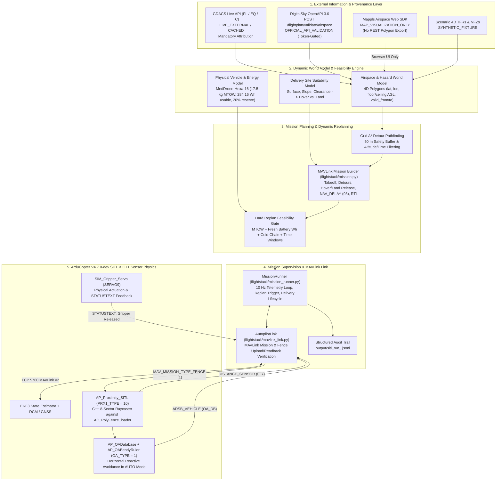

# Med-Drone Mission Control — System Architecture

## 1. Architectural Scope & Separation of Concerns

Med-Drone Mission Control is structured around **one primary autonomous UAV flight stack** executing end-to-end disaster-response medical deliveries in ArduPilot SITL, accompanied by a preserved multi-UAV vehicle-routing research module.

---

## 2. Primary Single-UAV Autonomy Stack vs. Preserved Fleet Simulator

| Subsystem | Module Paths | Operational Role | Status |
| :--- | :--- | :--- | :--- |
| **Primary Single-UAV Flight Stack** | `sitl_mission_demo.py`, `flightstack/mission.py`, `flightstack/mission_runner.py`, `flightstack/mavlink_link.py`, `flightstack/telemetry.py`, `flightstack/payload.py`, `flightstack/vehicle_model.py`, `gdacs_provider.py`, `airspace_provider.py` | Complete single-aircraft autonomous loop: live GDACS disaster ingestion, DigitalSky OpenAPI 3.0 validation, 4D NFZ conflict detection & A* replanning, ArduCopter SITL execution, C++ `AP_Proximity_SITL` obstacle avoidance, site-suitability delivery mode selection, and JSONL telemetry auditing. | **Primary Focus (Verified in SITL)** |
| **Multi-Drone Logistics / VRP Simulator** | `simulate_fleet.py`, `vrp_scratch.py`, `replan.py`, `distance_matrix.py`, `main.py` | Algorithmic Vehicle Routing Problem (CVRP) solver and discrete-time kinematic fleet simulator for multi-depot/multi-UAV research comparisons. | **Preserved Research Component** |
| **Simultaneous Multi-UAV SITL Control** | N/A | Multi-instance ArduPilot SITL swarm deconfliction and distributed traffic management. | **Deferred Future Extension** |

---

## 3. Data and Control Boundaries

1. **Simulated Ground Truth vs. Autopilot State Estimate vs. Planner State (`flightstack/telemetry.py`):**
   - **Simulated Ground Truth (`SIMSTATE`):** Internal to ArduPilot's physics engine (`SITL::SIM`) and C++ sensor raycaster (`AP_Proximity_SITL`). The Python mission planner **never** reads `SIMSTATE` to make navigation decisions.
   - **Autopilot Telemetry (`GLOBAL_POSITION_INT`, `GPS_RAW_INT`, `EKF_STATUS_REPORT`, `SYS_STATUS`, `BATTERY_STATUS`, `DISTANCE_SENSOR`, `ADSB_VEHICLE`):** Received over MAVLink TCP/UDP and stored with monotonic receive timestamps (`Stamped`). Position estimates are rejected if EKF3 horizontal position flags are unhealthy, GNSS fix is below 3D (`fix_type < 3`), coordinates are `(0, 0)`, or data is older than `stale_limit_s = 2.0 s`.
   - **Planner State (`RunnerState` & `PayloadManager`):** Tracks mission version, replan history, per-stop delivery state (`LOADED -> ARRIVED -> SITE_ASSESSED -> METHOD_SELECTED -> RELEASE_COMMANDED -> RELEASE_ACKNOWLEDGED -> CUSTODY_CONFIRMED -> DELIVERY_COMPLETE`), proximity observation frames, and cross-track avoidance deviation.

2. **Strategic Replanning vs. Tactical Obstacle Avoidance:**
   - **Strategic Airspace & Macro-Hazard Replanning (Python `MissionRunner`):** Handles 4D No-Fly Zones (`AirspaceZone` with `floor_m_agl`, `ceiling_m_agl`, `valid_from`, `valid_to`). On conflict detection, commands `LOITER`, computes a new A* detour mission (`build_delivery_mission`), enforces MTOW, fresh battery Wh reserve, cold-chain limits, and delivery windows, uploads the new mission, verifies item-by-item readback (`verify_mission_readback`), and resumes `AUTO`.
   - **Tactical Proximity Obstacle Avoidance (ArduCopter C++ `AP_Proximity_SITL` + `AP_OABendyRuler`):** Operates inside ArduPilot at main-loop rate in `AUTO` mode. `AP_Proximity_SITL` (`PRX1_TYPE = 10`) casts 8 horizontal rays in C++ against world obstacles loaded in `AC_PolyFence_loader`, updates `AP_OADatabase`, and `AP_OABendyRuler` (`OA_TYPE = 1`) smoothly bends the velocity/position target around the obstacle while streaming `DISTANCE_SENSOR` and `ADSB_VEHICLE` (`OA_DB`) telemetry back to `MissionRunner`.

